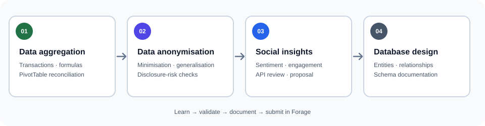

# Commonwealth Bank
## Introduction to Data Science — Forage Virtual Experience

  
  
  

  
  
  
  

  
  
  

**A task-by-task learning and portfolio project focused on practical data analysis, data handling, business reasoning, and reproducible documentation.**

[Simulation Brief](https://www.theforage.com/simulations/commonwealth-bank/intro-data-science-sd7t) · [Task 01 Guide](docs/task-01-data-aggregation-analysis.md) · [Task 02 Guide](docs/task-02-data-anonymisation.md) · [Task 03 Guide](docs/task-03-propose-data-analysis-approaches.md) · [Privacy Techniques](docs/data-privacy-techniques.md) · [CV / LinkedIn Positioning](docs/project-experience-positioning.md) · [Local Setup](docs/local-setup-windows.md) · [Learning Log](LEARNING_LOG.md)

  

  
  
  
  

---

> [!IMPORTANT]
> This is an independent learning repository documenting participation in a Forage virtual job simulation. It is **not** an official Commonwealth Bank or Forage repository and does not represent employment, a paid client engagement, or endorsement by either organisation.

> [!CAUTION]
> The Forage source workbook is labelled for simulation use only. Keep the downloaded source file, working copies containing the full dataset, and submitted analysis workbook out of this public repository. The `.gitignore` is configured to help prevent accidental commits.

## Project overview

The simulation uses practical business scenarios to develop data-science and data-management skills. This repository keeps each exercise reviewable through task guides, privacy references, working notes, documented methods, and validation decisions. Source workbooks, customer-level data, and private deliverables remain local.

| Project detail | Description |
|---|---|
| **Program** | Commonwealth Bank — Introduction to Data Science |
| **Provider** | Forage |
| **Format** | Self-paced virtual job simulation |
| **Primary practice tool** | Microsoft Excel Desktop for Tasks 01–03 |
| **Analytical methods** | Excel Tables, SUMIFS, COUNTIFS, PivotTables, data minimisation, generalisation, banding, disclosure-risk checks, CSV validation |
| **Completed analyses** | Task 01 — Data Aggregation and Analysis; Task 02 — Data Anonymisation workbook analysis and CSV preparation |
| **Current focus** | Task 03 — Social Media Data and Business Insights |

## Learning roadmap

~~~mermaid
flowchart TD
    A([Forage simulation]) --> B[Task 01 · Data aggregation and analysis]
    B --> B1[Inspect transaction data]
    B1 --> B2[Excel Table and data types]
    B2 --> B3[COUNTIFS and SUMIFS]
    B3 --> B4[PivotTable cross-checks]
    B4 --> B5[Document findings]
    B5 --> C[Task 02 · Data anonymisation and privacy review]
    C --> D[Task 03 · Social media insights]
    D --> E[Task 04 · Database design]
    E --> F([Consolidated learning portfolio])
~~~

| Task | Topic | Skills / methods | Status |
|:---:|---|---|:---:|
| **01** | Data Aggregation and Analysis | Excel Tables, `COUNTIFS`, `SUMIFS`, PivotTables, validation |  |
| **02** | Data Anonymisation | Direct and quasi-identifiers, generalisation, age/salary banding, k-anonymity-style and salary-diversity checks, CSV validation |  |
| **03** | Propose Data Analysis Approaches | Social-media topic, sentiment, engagement, trend, customer-support analysis, X API mapping, proposal writing |  |
| **04** | Designing a Database | Database structure, entities, attributes, relationships, and schema communication |  |

---

## Task 01 — Data Aggregation and Analysis

<strong>Business scenario · Supermarket transaction analysis</strong>

The team lead supplied a transaction dataset containing three years of supermarket activity across Australia. The requested analysis must answer three business questions before the sample is shared with InsightSpark.

### Questions to answer

| # | Business question | Aggregation |
|:---:|---|---|
| **01** | Across locations, how many apples were purchased in cash? | Count matching purchase records, or sum quantity if the row grain requires it |
| **02** | How much total cash was spent on these apples? | Sum transaction amount for apples paid in cash |
| **03** | Across all payment methods, how much money was spent at Bakershire by non-member customers? | Sum transaction amount for Bakershire non-members |

### Formula reference

After importing the source workbook and converting the dataset into an Excel Table named `Transactions`, use these as **field-name examples**. Verify the exact headers in the source file before entering them.

| Question | Excel formula pattern |
|---|---|
| Cash apple purchase records | `=COUNTIFS(Transactions[product_name],"apple",Transactions[payment_method],"cash")` |
| Cash spent on apples | `=SUMIFS(Transactions[total_amount],Transactions[product_name],"apple",Transactions[payment_method],"cash")` |
| Bakershire non-member spend | `=SUMIFS(Transactions[total_amount],Transactions[store],"Bakershire",Transactions[customer_type],"non-member")` |

> [!TIP]
> Counting matching rows is not necessarily the same as counting units sold. Inspect the dataset grain and any quantity column first. If one row can contain multiple apples, use `SUMIFS` over the quantity field for the unit count.

### Analysis and validation workflow

1. Inspect sheet names, headers, row grain, data types, and missing values.
2. Preserve the downloaded source file and create a separate working copy.
3. Format the data as an Excel Table named `Transactions`.
4. Calculate the requested metrics with conditional aggregation formulas.
5. Build PivotTables with the field layouts in the [Task 01 guide](docs/task-01-data-aggregation-analysis.md).
6. Reconcile formula outputs with the PivotTable results.
7. Document formulas, values, validation evidence, and business interpretation.

### Validated Task 01 results

The completed Excel analysis used `SUMIFS` and `COUNTIFS` and was independently reconciled with two PivotTables.

| Business metric | Validated result |
|---|---:|
| Apple units purchased in cash | **117** |
| Cash-paid apple transaction records | **20** |
| Total cash spent on apples | **$537.03** |
| Bakershire non-member spending (all payment methods) | **$2,857.51** |
| Bakershire non-member transaction records | **179** |

The source table contained **50,783** records. The formula outputs matched the corresponding PivotTable values. See the [Task 01 analysis guide](docs/task-01-data-aggregation-analysis.md) for data-quality checks, exact formulas, full PivotTable breakdowns, and limitations.

**Practice workbook:** [Task 01 Excel Practice Starter](workbooks/task-01-excel-practice-starter.xlsx)  
**Step-by-step instructions:** [Task 01 — Data Aggregation and Analysis](docs/task-01-data-aggregation-analysis.md)

## Task 02 — Data Anonymisation

The workbook analysis, transformation workflow, privacy checks, and values-only CSV export are complete. The 10,000-record source was reduced to four fields: `Registration_Year`, `Gender`, `Age_Band`, and `Salary_Band`. Direct identifiers, exact dates of birth, precise location data, the customer linkage key, high-cardinality employer/job fields, and unnecessary card details were removed.

**Verified aggregate results:** 10,000 release rows; four columns; zero blanks or `REVIEW` values; 40 quasi-identifier profiles; minimum profile size 111; zero records in groups smaller than five; all 40 profiles contain all five salary bands, with a minimum profile-by-salary count of 12. These are screening results, not a guarantee that re-identification is impossible.

This task was completed independently: no Task 01 transaction data was joined or used. The CSV has been generated and structurally validated; Forage upload/acceptance has not yet been verified.

**Resources:**
- [Task 02 completed workflow, field decisions, and QA results](docs/task-02-data-anonymisation.md)
- [Anonymisation techniques, linkage attacks, and k-anonymity limitations](docs/data-privacy-techniques.md)

Keep the source workbook, working workbook, customer-level CSV, and any identifier mappings outside this public repository.

## Task 03 — Propose Data Analysis Approaches

Task 03 is in progress. The supplied workbook contains 60 fictional social-media records across 24 fields and five worksheets. Dataset profiling, engagement comparisons by topic, content format, post type, and author type, and both sentiment PivotTables are validated. Time analysis is also validated: 25 posts in April, 27 in May, and 8 in June 2026 (the sample ends on June 12); weekday counts are Tuesday 11, Wednesday 11, Thursday 10, Friday 8, Saturday 7, Sunday 7, and Monday 6. The response-needed PivotTable reconciles to 11 records: 10 Negative and 1 Neutral. The flagged records group into five complaints, five questions, and one scam report. The official X API field, search-access, metrics, and published pricing documentation has been reviewed and documented. The private row-level qualitative review and InsightSpark proposal remain open.

### Validated topic and engagement results

The topic PivotTable contains 11 categories and reconciles to 60 records. Digital banking is the most frequent topic (13 posts), followed by Fraud & scams (11) and Financial wellbeing (9). These three categories represent 33 of 60 records (55%).

The topic-level engagement PivotTable reconciles to **125,989 total engagements** and **2,906,190 views**. The overall weighted engagement rate is **4.34%**.

| Topic | Posts | Total engagements | Weighted engagement rate |
|---|---:|---:|---:|
| Fraud & scams | 11 | 36,283 | 5.33% |
| Financial wellbeing | 9 | 23,309 | 4.54% |
| Security education | 5 | 22,360 | 5.08% |
| Digital banking | 13 | 21,176 | 3.92% |
| Card services | 4 | 8,303 | 4.31% |
| Community | 4 | 8,279 | 3.48% |
| Business banking | 3 | 2,671 | 4.46% |
| Sustainability | 2 | 1,787 | 1.76% |
| Outage/service issue | 5 | 1,714 | 1.30% |
| Branch/ATM | 3 | 90 | 1.57% |
| Customer support | 1 | 17 | 0.81% |

Fraud & scams has the highest total engagements and topic-level weighted rate. Security education has the highest average engagements per post (4,472), based on 22,360 engagements across five posts. Digital banking appears most often but its weighted rate (3.92%) is below the overall 4.34%. These are descriptive results from a small fictional sample, not evidence of real CommBank campaign performance or customer opinion. The workbook's total-engagement measure includes link clicks; the guide explains why this should not be assumed to be a generally available public X metric.

### Engagement by content format

The format PivotTable also reconciles to the QA totals. Text + video has the highest weighted engagement rate (5.17%) across four posts; Text + image has the highest total engagement (73,358) across 14 posts and a 4.61% weighted rate. Text-only is the most common format (36 posts, 60% of the sample), but its weighted rate is 1.44%. The small video sample and differences in topic, purpose, author and reach mean these are descriptive associations, not evidence that format alone caused engagement.

| Content format | Posts | Total engagements | Views | Weighted rate |
|---|---:|---:|---:|---:|
| Link | 6 | 21,738 | 526,900 | 4.13% |
| Text | 36 | 3,809 | 264,990 | 1.44% |
| Text + image | 14 | 73,358 | 1,590,300 | 4.61% |
| Text + video | 4 | 27,084 | 524,000 | 5.17% |
| **Overall** | **60** | **125,989** | **2,906,190** | **4.34%** |

### Engagement by post type

The post-type PivotTable reconciles to the same 60 posts, 125,989 engagements, and 2,906,190 views. Original posts account for 123,337 engagements (about 97.9%) from 24 records, with a 4.52% weighted rate. Mentions (17 posts) and replies (16 posts) have weighted rates of 1.51% and 1.60%; quote posts are represented by only three records. Because post types have different purposes, and post type does not itself identify the author, these results should be interpreted alongside `author_type` rather than as a direct content-quality ranking.

| Post type | Posts | Total engagements | Views | Weighted rate |
|---|---:|---:|---:|---:|
| Original post | 24 | 123,337 | 2,730,800 | 4.52% |
| Mention | 17 | 1,112 | 73,530 | 1.51% |
| Reply | 16 | 919 | 57,260 | 1.60% |
| Quote post | 3 | 621 | 44,600 | 1.39% |
| **Overall** | **60** | **125,989** | **2,906,190** | **4.34%** |

### Engagement by author type

The author-type PivotTable was validated across all six categories. CommBank-authored records account for 123,593 engagements across 26 posts and 2,754,800 views (4.49% weighted rate). Customer-authored records account for 1,597 engagements across 28 posts and 96,990 views (1.65%). CommBank posts contributed about 98.1% of recorded engagements in this sample. This is not a customer-satisfaction comparison: author groups have different purposes, content types, and reach. The smaller non-core author groups have only one or two records.

| Author type | Posts | Total engagements | Views | Weighted rate |
|---|---:|---:|---:|---:|
| Customer | 28 | 1,597 | 96,990 | 1.65% |
| CommBank | 26 | 123,593 | 2,754,800 | 4.49% |
| Business customer | 2 | 97 | 5,600 | 1.73% |
| Community org | 2 | 237 | 11,100 | 2.14% |
| Scam awareness org | 1 | 137 | 6,700 | 2.04% |
| News/media | 1 | 328 | 31,000 | 1.06% |
| **Overall** | **60** | **125,989** | **2,906,190** | **4.34%** |

### Time and customer-support findings

The monthly PivotTable reconciles to 60 posts: April 25 (41.7%), May 27 (45.0%), and June 8 (13.3%). June is partial because the sample ends on June 12, 2026. Weekday counts are Tuesday 11, Wednesday 11, Thursday 10, Friday 8, Saturday 7, Sunday 7, and Monday 6. These are descriptive counts from a short simulated sample, not evidence of long-term seasonality or an optimal publishing schedule.

The `response_needed = Yes` PivotTable reconciles to 11 records: 10 Negative and one Neutral. Customer intent consists of five Complaints, five Questions, and one Scam report. The topic split is Branch/ATM (3), Digital banking (3), Fraud & scams (2), Outage/service issue (2), and Card services (1). The row-level `Customer_Support_Review` worksheet and manual theme/action review are the next checkpoint; do not infer the content or urgency of an individual post from aggregate counts.

**Remaining Task 03 work:** complete the private row-level customer/support review, summarise recurring themes from the actual post text, and write and submit the InsightSpark proposal. The current X API technical review is documented in the Task 03 guide; account-specific access, budget, and production approvals are not assumed. Do not mark Task 03 complete until the proposal is submitted through Forage.

See the [Task 03 guide](docs/task-03-propose-data-analysis-approaches.md) for formulas, complete topic-level results, interpretation, API mapping, limitations, and the step-by-step workflow.

## Repository structure

~~~text
commonwealth-bank-intro-data-science/
├── .github/
│   ├── ISSUE_TEMPLATE/analysis-checkpoint.yml
│   └── PULL_REQUEST_TEMPLATE.md
├── assets/
│   ├── icons/                 # Accessible, original SVG task icons
│   └── workflow.svg           # Four-task roadmap graphic
├── docs/
│   ├── data-privacy-techniques.md
│   ├── local-setup-windows.md
│   ├── project-experience-positioning.md
│   ├── repository-maintenance.md
│   ├── task-01-data-aggregation-analysis.md
│   ├── task-02-data-anonymisation.md
│   ├── task-03-propose-data-analysis-approaches.md
│   └── task-04-designing-a-database.md
├── workbooks/                 # Generic practice templates only
├── CONTRIBUTING.md
├── SECURITY.md
├── LEARNING_LOG.md
├── README.md
└── data/                      # Local-only; ignored by Git
    ├── raw/
    └── working/
~~~

## Work locally

Clone the repository into its own project subfolder under the Data Analysis course directory:

~~~powershell
$Parent = "D:\courses\Data Analysis 26-27"
$RepoPath = Join-Path $Parent "commonwealth-bank-intro-data-science"

New-Item -ItemType Directory -Force -Path $Parent | Out-Null
git clone https://github.com/Sohila-Khaled-Abbas/commonwealth-bank-intro-data-science.git $RepoPath
Set-Location $RepoPath
git status
~~~

See [Local Setup — Windows and Microsoft Excel](docs/local-setup-windows.md) for the full workflow, including where to place the private Forage workbook.

## Documentation and learning resources

| Resource | Description |
|---|---|
| [Task 01 guide](docs/task-01-data-aggregation-analysis.md) | Completed Excel analysis, formulas, PivotTables, data-quality checks, and reconciliation |
| [Task 02 guide](docs/task-02-data-anonymisation.md) | Data inventory, transformation decisions, linkage, privacy checks, and CSV delivery |
| [Task 03 guide](docs/task-03-propose-data-analysis-approaches.md) | Social-media profiling, engagement, sentiment, support review, X API feasibility, and proposal |
| [Task 04 starter guide](docs/task-04-designing-a-database.md) | Database-design workflow and evidence checklist; refine against the exact Forage prompt |
| [Privacy techniques](docs/data-privacy-techniques.md) | Direct identifiers, quasi-identifiers, pseudonymisation, linkage attacks, and k-anonymity |
| [Project positioning](docs/project-experience-positioning.md) | Accurate CV, LinkedIn, portfolio, and interview wording |
| [Excel starter workbook](workbooks/task-01-excel-practice-starter.xlsx) | Task 01 practice sheets, formula reference, PivotTable guide, and blank analysis area |
| [Contribution standards](CONTRIBUTING.md) | Evidence, privacy, documentation, and commit conventions |
| [Security and privacy policy](SECURITY.md) | Sensitive-data handling and incident response |
| [Repository maintenance](docs/repository-maintenance.md) | Task status vocabulary, pre-commit checks, and safe Git sync |
| [Workbook directory notes](workbooks/README.md) | Task 02 and Task 03 companion workbook scope, local source-data handling, and reproducibility notes |
| [Learning log](LEARNING_LOG.md) | Task progress, verified results, decisions, and reflection prompts |
| [Windows setup](docs/local-setup-windows.md) | Clone, private data folders, Excel workflow, and safe Git practices |

## Project-based experience

This repository is an independent, task-by-task project based on the Commonwealth Bank Introduction to Data Science virtual experience on Forage. Task 01 is complete and reconciled. Task 02's workbook analysis, privacy checks, and CSV preparation are complete, while Forage upload/acceptance is not yet verified. Task 03 profiling, engagement comparisons, sentiment PivotTables, monthly and weekday counts, and the 11-record response-needed PivotTable are validated. The private row-level customer/support review, X API feasibility review, and InsightSpark proposal remain in progress. Task 04 is planned. It is not employment at Commonwealth Bank or a paid freelance engagement.

**CV-ready title:** Data Analytics & Data Science Virtual Experience | Forage — Commonwealth Bank Simulation

The verified scope includes analysis of 50,783 supermarket records in Excel, conditional aggregation and PivotTable reconciliation, plus a 10,000-record customer-data de-identification exercise with 40 generalised profiles, minimum group size 111, and salary-diversity checks. Task 03 includes validated topic, format, post-type, author-type, sentiment, time, and response-needed aggregate analyses for a 60-record fictional social-media sample (125,989 engagements, 2,906,190 views, 4.34% weighted rate). Row-level review, X API feasibility, and the InsightSpark proposal remain pending. See [CV and LinkedIn positioning guidance](docs/project-experience-positioning.md). Do not claim later tasks as completed until they have been performed and validated.

## Quality and portfolio standards

- **Reproducibility:** Keep the source, working copy, formulas, and validation steps distinct.
- **Traceability:** Document exact formulas, criteria, data grain, and assumptions.
- **Accuracy:** Cross-check formula results independently with PivotTables.
- **Privacy and licensing:** Do not publish Forage-provided materials marked for simulation-only use.
- **Honest representation:** Describe completed work as a virtual job simulation and independent learning project, not paid freelance experience or employment.
- **Evidence-led completion:** Change task badges and completion dates only after work has been completed and reviewed.
- **Accessible visuals:** Use original SVG diagrams with descriptive alternative text; keep the underlying workflow documented in Markdown.
- **Repository hygiene:** Follow [CONTRIBUTING.md](CONTRIBUTING.md), [SECURITY.md](SECURITY.md), and the [maintenance checklist](docs/repository-maintenance.md).

## References

- [Forage — Commonwealth Bank Introduction to Data Science](https://www.theforage.com/simulations/commonwealth-bank/intro-data-science-sd7t)
- [Microsoft Support — Overview of formulas in Excel](https://support.microsoft.com/en-us/office/overview-of-formulas-in-excel-ecfdc708-9162-49e8-b993-c311f47ca173)
- [Microsoft Support — Sort data in a worksheet](https://support.microsoft.com/en-us/office/quick-start-sort-data-in-an-excel-worksheet-60153f94-d782-47e2-96a8-15cbb7712539)
- [Microsoft Support — Filter data in a range or table](https://support.microsoft.com/en-us/office/filter-data-in-a-range-or-table-01832226-31b5-4568-8806-38c37dcc180e)

---

**Built as a practical learning record — from raw data inspection to validated business answers.**

Maintained as part of an independent data analytics learning portfolio.

