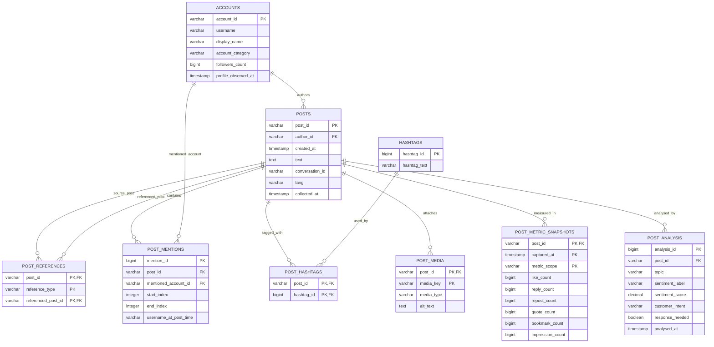

# Task 04 — Designing a Database

> **Design status:** Schema proposal prepared and checked against the Forage scenarios.  
> **Forage program:** Overall simulation completed on 14 November 2026; the provider completion page does not expose a separate Task 04 response-field receipt in this repository.  
> **Scope:** Public X posts authored by CommBank, user replies, user quote posts, and public posts that directly mention the CommBank account. Private Direct Messages are outside this task's stated scope.

## 1. Task objective and required deliverable

The Forage task asks for a database structure that stores:

1. Posts published by the CommBank X account.
2. User replies to CommBank posts.
3. User quote retweets / quote posts that refer to CommBank posts.
4. User posts that directly mention the CommBank account.

The required response must include:

- The proposed tables.
- The fields in every table, with a variable name and short description.
- The primary key for each table.
- The relationships between tables.

This is a database-design proposal. The task does not require a deployed database, SQL implementation, live X API connection, or production data collection. The proposal below is relational and implementation-neutral.

**Terminology decision:** In this design, a *direct mention* means a public post containing an @mention of the CommBank account. It does not mean a private X Direct Message. This interpretation follows the task's wording about tweets, replies, quote retweets, and mentions.

## 2. Design principles

The design follows the steps in Microsoft's *Database Design Basics*: determine the purpose, identify the information, divide it into subject-based tables, define columns, choose primary keys, establish relationships, refine the design, and apply normalisation checks.

The main principles applied here are:

- Store each post once. A reply or quote post is its own post; the post it refers to is not copied into it.
- Keep account attributes in an Accounts table rather than repeating usernames and profile details on every post.
- Use stable platform IDs as keys. A username is mutable and must not be used as the primary key.
- Represent arrays and repeating values (mentions, hashtags, media references) as related rows rather than comma-separated strings or numbered columns.
- Resolve many-to-many relationships with junction tables.
- Keep source facts separate from classifications and calculated analytics.
- Capture metric values with a collection timestamp because engagement counts change over time.
- Distinguish core tables required for the task from optional analytics extensions.

## 3. Data grain and interaction logic

**Core grain:** One row in `Posts` represents one distinct public X post, regardless of whether it was authored by CommBank or a user.

| Scenario | Representation |
|---|---|
| Original CommBank post | One row in `Posts`; `author_id` points to CommBank's row in `Accounts`. |
| User reply to a CommBank post | One separate user-authored row in `Posts`, plus a `replied_to` row in `Post_References`. |
| User quote post referring to a CommBank post | One separate user-authored row in `Posts`, plus a `quoted` row in `Post_References`. |
| Public user post directly mentioning CommBank | One row in `Posts`, plus a row in `Post_Mentions` pointing to the CommBank account. |
| Reply that also mentions CommBank | One row in `Posts`, one `replied_to` relationship, and one mention association. The post is not duplicated. |

A mention is not mutually exclusive with a reply or quote. Keeping references and mentions as separate relationships allows one post to have more than one interaction characteristic.

## 4. Core relational schema

The six core tables below cover the Forage requirement. The three later tables are optional extensions for media and Task 03-style analytics.

### 4.1 `Accounts`

**Purpose:** Store each X account once, including the official CommBank account and the user accounts that author or are mentioned in collected posts.

**Primary key:** `account_id`

| Field | Suggested type | Key / nullability | Description |
|---|---|---|---|
| `account_id` | VARCHAR(32) | PK, NOT NULL | Stable X account identifier returned by the platform. |
| `username` | VARCHAR(100) | NULL allowed | Account handle at the time the profile was observed; it can change and is not a key. |
| `display_name` | VARCHAR(200) | NULL allowed | Public display name at the time the profile was observed. |
| `account_category` | VARCHAR(40) | NULL allowed | Optional internal classification such as CommBank or user/customer; an analyst-assigned label, not a native X account field. |
| `followers_count` | BIGINT | NULL allowed | Exact follower count only when actually returned and permitted by the API access used; never infer it from a band or bucket. |
| `profile_observed_at` | TIMESTAMPTZ | NULL allowed | Time the profile attributes were collected, useful because profile values can change. |

### 4.2 `Posts`

**Purpose:** Store the text and core metadata for each unique public post.

**Primary key:** `post_id`

| Field | Suggested type | Key / nullability | Description |
|---|---|---|---|
| `post_id` | VARCHAR(32) | PK, NOT NULL | Unique X post identifier. Store the ID as text to preserve the platform identifier exactly. |
| `author_id` | VARCHAR(32) | FK to Accounts, NOT NULL | Account that published the post. |
| `created_at` | TIMESTAMPTZ | NOT NULL | Original post creation timestamp, stored in UTC. |
| `text` | TEXT | NOT NULL where returned | Post text. Apply the platform's permitted collection and retention rules. |
| `conversation_id` | VARCHAR(32) | NULL allowed; index | Identifier of the root post in the conversation. It is used to group conversation posts; it is not a separate Conversations table in this design. |
| `lang` | VARCHAR(20) | NULL allowed | Language code returned by the API, when available. |
| `collected_at` | TIMESTAMPTZ | NOT NULL | Time this post record was collected into the database. |

The official CommBank account is represented by a normal row in `Accounts`. CommBank-authored posts are identified by matching `Posts.author_id` to that account's ID; no separate CommBank-post table is needed.

### 4.3 `Post_References`

**Purpose:** Link a reply or quote post to the post that it references. This is a self-referencing relationship between rows in `Posts`.

**Primary key:** Composite key `(post_id, reference_type, referenced_post_id)`

| Field | Suggested type | Key / nullability | Description |
|---|---|---|---|
| `post_id` | VARCHAR(32) | PK part; FK to Posts, NOT NULL | The reply or quote post that contains the reference. |
| `reference_type` | VARCHAR(20) | PK part, NOT NULL | Reference category, such as `replied_to` or `quoted`. |
| `referenced_post_id` | VARCHAR(32) | PK part; FK to Posts, NOT NULL | The original or parent post being referenced. |

For the required Forage scenarios, store the CommBank post being referenced in `Posts` as well, so the foreign key can be enforced. A database may extend the allowed reference types later if pure reposts or other reference categories enter scope.

### 4.4 `Post_Mentions`

**Purpose:** Record every account mentioned in a post. This is a junction/association table between `Posts` and `Accounts`.

**Primary key:** `mention_id`

| Field | Suggested type | Key / nullability | Description |
|---|---|---|---|
| `mention_id` | BIGINT | PK, NOT NULL | Generated identifier for one mention occurrence. |
| `post_id` | VARCHAR(32) | FK to Posts, NOT NULL | Post containing the mention. |
| `mentioned_account_id` | VARCHAR(32) | FK to Accounts, NOT NULL | Account that is mentioned; for the task's target mention, this is CommBank's account ID. |
| `start_index` | INTEGER | NULL allowed | Start position of the mention in the text, when provided by the API. |
| `end_index` | INTEGER | NULL allowed | End position of the mention in the text, when provided by the API. |
| `username_at_post_time` | VARCHAR(100) | NULL allowed | Handle shown in the post at collection time, if useful for audit/display. |

A post can mention several accounts, and an account can be mentioned by many posts. A generated key also permits the same account to be mentioned more than once in one post if the source provides distinct mention positions.

### 4.5 `Hashtags`

**Purpose:** Maintain a distinct list of hashtag values so the same hashtag is not repeated as a full text value in every post relationship.

**Primary key:** `hashtag_id`

| Field | Suggested type | Key / nullability | Description |
|---|---|---|---|
| `hashtag_id` | BIGINT | PK, NOT NULL | Generated identifier for a distinct hashtag. |
| `hashtag_text` | VARCHAR(280) | UNIQUE, NOT NULL | Hashtag text without the leading #, preserving its display form. |

A case-normalised comparison can be used for uniqueness, while the display value can preserve the observed spelling.

### 4.6 `Post_Hashtags`

**Purpose:** Resolve the many-to-many relationship between posts and hashtags.

**Primary key:** Composite key `(post_id, hashtag_id)`

| Field | Suggested type | Key / nullability | Description |
|---|---|---|---|
| `post_id` | VARCHAR(32) | PK part; FK to Posts, NOT NULL | Post containing the hashtag. |
| `hashtag_id` | BIGINT | PK part; FK to Hashtags, NOT NULL | Hashtag associated with the post. |

The composite primary key prevents the same hashtag association from being inserted twice for the same post.

## 5. Optional extensions

These tables are not necessary to satisfy the four core interaction scenarios, but they make the model more useful for the analysis already performed in Task 03.

### 5.1 `Post_Media` — optional

**Purpose:** Store media attachments as separate rows because one post can contain more than one media key.

**Primary key:** Composite key `(post_id, media_key)`

| Field | Suggested type | Key / nullability | Description |
|---|---|---|---|
| `post_id` | VARCHAR(32) | PK part; FK to Posts, NOT NULL | Post that contains the media. |
| `media_key` | VARCHAR(64) | PK part, NOT NULL | Platform media identifier from the attachment expansion. |
| `media_type` | VARCHAR(30) | NULL allowed | Media type such as photo, video, or animated GIF, when returned. |
| `alt_text` | TEXT | NULL allowed | Available alternative text for the attachment. |

The API's `attachments.media_keys` array becomes one row per media attachment. The media expansion and its fields depend on the API request and access available.

### 5.2 `Post_Metric_Snapshots` — optional

**Purpose:** Store changing post metrics as time-stamped observations rather than overwriting earlier counts.

**Primary key:** Composite key `(post_id, captured_at, metric_scope)`

| Field | Suggested type | Key / nullability | Description |
|---|---|---|---|
| `post_id` | VARCHAR(32) | PK part; FK to Posts, NOT NULL | Post whose metrics were collected. |
| `captured_at` | TIMESTAMPTZ | PK part, NOT NULL | Time the metrics were observed. |
| `metric_scope` | VARCHAR(20) | PK part, NOT NULL | Metric context, such as public, non-public, organic, or promoted. |
| `like_count` | BIGINT | NULL allowed | Like count, when returned. |
| `reply_count` | BIGINT | NULL allowed | Reply count, when returned. |
| `repost_count` | BIGINT | NULL allowed | Repost count, when returned. |
| `quote_count` | BIGINT | NULL allowed | Quote-post count, when returned. |
| `bookmark_count` | BIGINT | NULL allowed | Bookmark count, when returned. |
| `impression_count` | BIGINT | NULL allowed | Post impression count, when returned. |
| `url_link_clicks` | BIGINT | NULL allowed | Non-public URL click metric; only store when the required user-context access and ownership conditions are met. |
| `user_profile_clicks` | BIGINT | NULL allowed | Non-public profile-click metric, subject to access restrictions. |
| `engagements` | BIGINT | NULL allowed | Non-public total engagement metric, subject to access restrictions. |

Metric fields may be NULL when a metric is unavailable. Do not replace missing values with zero. X documentation distinguishes public post metrics from non-public, organic, and promoted metrics; the latter require user-context authentication and are available only for the account owner's recent posts under the documented time limit. Video views are media-level metrics and should not be mislabeled as post impressions.

### 5.3 `Post_Analysis` — optional

**Purpose:** Store derived labels and analytical outputs separately from the original source post.

**Primary key:** `analysis_id`

| Field | Suggested type | Key / nullability | Description |
|---|---|---|---|
| `analysis_id` | BIGINT | PK, NOT NULL | Generated identifier for one analysis result. |
| `post_id` | VARCHAR(32) | FK to Posts, NOT NULL | Post being analysed. |
| `topic` | VARCHAR(100) | NULL allowed | Assigned or predicted topic. |
| `sentiment_label` | VARCHAR(30) | NULL allowed | Sentiment category. |
| `sentiment_score` | DECIMAL(7,6) | NULL allowed | Model or scoring-system output, if used. |
| `customer_intent` | VARCHAR(50) | NULL allowed | Intent such as complaint, question, or praise. |
| `response_needed` | BOOLEAN | NULL allowed | Business-rule or reviewer decision on whether follow-up is indicated. |
| `analysis_method` | VARCHAR(50) | NULL allowed | Manual, rules-based, or model-based method. |
| `model_version` | VARCHAR(100) | NULL allowed | Model or ruleset version, if applicable. |
| `analysed_at` | TIMESTAMPTZ | NOT NULL | Time the analysis result was produced. |

This table supports re-analysis without overwriting the source post. The supplied Task 03 topic and sentiment labels were curated simulation fields; this proposed table does not imply that a predictive model was trained in the exercise.

## 6. Relationship definitions

| Parent / referenced table | Child / associating table | Cardinality | Key used | Meaning |
|---|---|---|---|---|
| Accounts | Posts | 1:M | `Posts.author_id` → `Accounts.account_id` | One account can author many posts; each post has one author. |
| Posts (source post) | Post_References | 1:M | `Post_References.post_id` → `Posts.post_id` | One post can have one or more reference records. |
| Posts (referenced post) | Post_References | 1:M | `Post_References.referenced_post_id` → `Posts.post_id` | One CommBank post can be referenced by many replies or quote posts. |
| Posts | Post_Mentions | 1:M | `Post_Mentions.post_id` → `Posts.post_id` | A post can contain multiple account mentions. |
| Accounts | Post_Mentions | 1:M | `Post_Mentions.mentioned_account_id` → `Accounts.account_id` | An account can be mentioned in many posts. |
| Posts | Post_Hashtags | 1:M | `Post_Hashtags.post_id` → `Posts.post_id` | A post can have multiple hashtag associations. |
| Hashtags | Post_Hashtags | 1:M | `Post_Hashtags.hashtag_id` → `Hashtags.hashtag_id` | A hashtag can be used by many posts. |
| Posts | Post_Media (optional) | 1:M | `Post_Media.post_id` → `Posts.post_id` | A post can contain multiple media attachments. |
| Posts | Post_Metric_Snapshots (optional) | 1:M | `Post_Metric_Snapshots.post_id` → `Posts.post_id` | A post can have multiple metric snapshots over time. |
| Posts | Post_Analysis (optional) | 1:M | `Post_Analysis.post_id` → `Posts.post_id` | A post can have multiple analysis runs or reviewed versions. |

Posts and Accounts have a many-to-many relationship for mentions; `Post_Mentions` resolves it. Posts and Hashtags also have a many-to-many relationship; `Post_Hashtags` resolves it. `Post_References` represents a self-referencing Posts-to-Posts relationship.

## 7. Entity relationship diagram

The diagram shows the core model and optional analytical extensions.

## 8. Source-field mapping decisions and corrections

The Task 03 workbook is a simplified simulation dataset, not a complete X API response. The mapping is therefore a bridge from the exercise fields to the proposed schema, not a claim that all fields are returned by every X endpoint.

| Task 03 / API field | Final treatment in this design |
|---|---|
| `post_id` / X `id` | `Posts.post_id`; primary key. |
| `post_datetime` / X `created_at` | `Posts.created_at`; store as UTC timestamp. |
| `post_text` / X `text` | `Posts.text`; keep source text separate from analysis labels. |
| X `author_id` | `Posts.author_id` references `Accounts.account_id`. |
| X User `username` | `Accounts.username`; mutable descriptive attribute, not a key. |
| Task 03 `author_type` | Optional internal `Accounts.account_category`; this is a business classification from the simulation, not a native X account field. |
| Task 03 `author_follower_bucket` | Do **not** map a bucket to an exact `followers_count`. Keep the category only in local analysis, or use a separately named derived bucket if the use case requires it. Populate exact followers count only from an actual permitted API value. |
| Task 03 `post_type` | Do not rely on a single mutually exclusive post-type column. Use `Post_References.reference_type` for reply/quote relationships and `Post_Mentions` for mentions. A post can satisfy more than one condition. |
| X `conversation_id` | `Posts.conversation_id`; root conversation identifier, useful for grouping. No separate Conversations table is necessary for this task. |
| X `referenced_tweets` | One `Post_References` row per referenced post and reference type. Use the referenced post's ID, not `in_reply_to_user_id`, as the post-to-post key. |
| X `in_reply_to_user_id` | Optional validation/context value: identifies the author of the replied-to post, not the parent post ID. It can be checked against the referenced post's `author_id`; it is not a substitute for `referenced_tweets`. |
| Task 03 `hashtags` / X `entities.hashtags` | One row per tag in `Hashtags`, linked through `Post_Hashtags`. |
| Task 03 `mentions_commbank` / X `entities.mentions` | Store the mentioned account ID in `Post_Mentions`. Do not store only a Yes/No flag; the association identifies which account was mentioned. |
| X `attachments.media_keys` | Optional `Post_Media` child rows, one per media key. |
| Task 03 `content_format` | Derive from available media and URL/attachment information. If persisted for reporting, treat it as a derived classification, not a raw API fact. |
| Task 03 likes, replies, reposts, quote posts, views, link clicks | Optional `Post_Metric_Snapshots`, with a collection timestamp and metric scope. The exact fields available depend on the endpoint and authentication. |
| Task 03 `topic`, `sentiment_label`, `sentiment_score`, `customer_intent`, `response_needed` | Optional `Post_Analysis`; derived or reviewed outputs, not original post attributes. |
| Task 03 `total_engagements`, `engagement_rate` | Calculate in a query or reporting view from available metrics; avoid storing duplicate calculated values without a justified snapshot requirement. |
| Task 03 `day_of_week` | Derive from `Posts.created_at` in the reporting layer. |
| `api_field_examples` | Documentation only; not a database record. |

### API and measurement caveats

The official X data dictionary describes Post fields such as `id`, `text`, `author_id`, `conversation_id`, `created_at`, `entities`, `referenced_tweets`, and `attachments`. Mentions, hashtags, and media keys are structured/array-style information, which is why the design converts them into related rows rather than placing a list inside one database cell.

The current X metrics documentation separates public metrics from non-public, organic, and promoted metrics. Public post metrics include likes, replies, reposts, quotes, bookmarks, and impressions. Non-public metrics such as URL clicks, profile clicks, and total engagements require user-context authentication; the documented non-public/organic/promoted availability window is limited to posts created within the last 30 days. Video views are returned at the media level and should not be conflated with post impressions.

Consequently:
- Do not assume the Task 03 `link_clicks` field is available for arbitrary public posts.
- Do not automatically treat a simulation field called `views` as the same thing as video views. Map post impressions and media views to their correct levels.
- Allow metric fields to be NULL when not returned; missing does not mean zero.
- Confirm the actual requested fields, expansions, access tier, and permissions before any production collection.

## 9. Normalisation, integrity, and privacy checks

- **1NF:** Each field stores one value. Hashtags, mentions, media keys, and post references are separate rows, not delimited lists.
- **2NF:** In junction tables, non-key information must depend on the whole composite key. The core `Post_Hashtags` table contains only the two key columns.
- **3NF:** Account profile attributes live in `Accounts`; post attributes live in `Posts`; analytical outputs live in `Post_Analysis`; metric observations live in `Post_Metric_Snapshots`.
- **Key integrity:** Platform IDs are primary keys for source entities. Foreign keys prevent references to non-existent stored accounts/posts. Unique constraints prevent duplicate hashtag text and duplicate associations.
- **No duplicate parent content:** A reply or quote post has its own `post_id`; the referenced post remains one separate record.
- **Minimum necessary data:** Store only public posts and account fields needed for the task. Do not ingest private messages or unrelated profile attributes.
- **Retention and platform rules:** Collection, storage, display, and deletion must follow the current X terms, API access conditions, and applicable privacy requirements. No API credentials or production access were created for this exercise.

## 10. Validation scenarios

The proposed model was checked conceptually against the following cases:

| Test | Example rows expected | Expected result |
|---|---|---|
| Original CommBank post | One CommBank row in `Accounts`; one post in `Posts` | Post author resolves to the CommBank account. |
| User reply | One user account, one user post, one `replied_to` reference row, plus the CommBank parent post | Reply and parent remain distinct; reference joins them. |
| User quote post | One user account, one quote post, one `quoted` reference row, plus the CommBank post | Quote text is stored once; referenced post is not copied. |
| Direct @CommBank mention | One user post and one `Post_Mentions` row pointing to CommBank | The post is discoverable as a mention even if it is not a reply. |
| Reply that also mentions CommBank | One post, one reply reference, one mention row | Both relationships are retained without duplicating the post. |
| Post with multiple hashtags or media | One post and multiple child/junction rows | No numbered columns or comma-separated arrays are required. |

For the reference foreign key to work, the referenced CommBank post must also be inserted into `Posts`. A collection process should ingest or look up the referenced parent post before inserting its relationship row; unresolved source references should be staged for reconciliation rather than silently discarded.

## 11. Recommended implementation sequence (not performed)

1. Create the `Accounts` table and upsert the CommBank account and observed user accounts by stable account ID.
2. Insert the original CommBank posts and collected user posts into `Posts`.
3. Insert reply and quote relationships into `Post_References`.
4. Parse account mentions and insert the relevant accounts plus `Post_Mentions` rows.
5. Parse hashtags and insert distinct values into `Hashtags`, then link them with `Post_Hashtags`.
6. Add optional media, metrics, and analysis rows only when those use cases are approved and the relevant fields are accessible.
7. Validate foreign keys, uniqueness, missing values, and the five interaction scenarios before reporting.

This sequence is a design recommendation only. No database was created or populated.

## 12. Forage submission-ready response

The following response is written to satisfy the four items requested in the Forage task. The six core tables address the required storage scenario; the final three are identified as optional extensions.

### Proposed tables and fields

**1. Accounts — PK: `account_id`**

- `account_id`: unique X account identifier.
- `username`: account handle; may change, so it is not the primary key.
- `display_name`: public display name.
- `account_category`: optional internal label distinguishing CommBank and other account categories.
- `followers_count`: optional exact count only if actually available and permitted.
- `profile_observed_at`: time the account profile was collected.

**2. Posts — PK: `post_id`**

- `post_id`: unique X post identifier.
- `author_id`: foreign key to Accounts; identifies the post author.
- `created_at`: post creation timestamp in UTC.
- `text`: post text.
- `conversation_id`: root post identifier used to group a conversation.
- `lang`: language code, when available.
- `collected_at`: time the post was collected.

CommBank posts are the Posts records whose `author_id` matches the CommBank account in Accounts. User replies and quote posts are also stored here as separate post records.

**3. Post_References — composite PK: `(post_id, reference_type, referenced_post_id)`**

- `post_id`: foreign key to Posts; the reply or quote post.
- `reference_type`: reference type such as `replied_to` or `quoted`.
- `referenced_post_id`: foreign key to Posts; the post being replied to or quoted.

**4. Post_Mentions — PK: `mention_id`**

- `mention_id`: generated identifier for one mention occurrence.
- `post_id`: foreign key to Posts; the post containing the mention.
- `mentioned_account_id`: foreign key to Accounts; the account being mentioned.
- `start_index` and `end_index`: optional text positions for the mention.
- `username_at_post_time`: optional handle as it appeared when collected.

**5. Hashtags — PK: `hashtag_id`**

- `hashtag_id`: generated identifier for a distinct hashtag.
- `hashtag_text`: unique hashtag text without the leading #.

**6. Post_Hashtags — composite PK: `(post_id, hashtag_id)`**

- `post_id`: foreign key to Posts.
- `hashtag_id`: foreign key to Hashtags.

**Optional extensions**

**7. Post_Media — composite PK: `(post_id, media_key)`**

- `post_id`: foreign key to Posts.
- `media_key`: platform identifier for one attached media object.
- `media_type`: photo, video, or other returned media type.
- `alt_text`: alternative text, when available.

**8. Post_Metric_Snapshots — composite PK: `(post_id, captured_at, metric_scope)`**

- `post_id`: foreign key to Posts.
- `captured_at`: time metrics were collected.
- `metric_scope`: public, non-public, organic, or promoted metric context.
- `like_count`, `reply_count`, `repost_count`, `quote_count`, `bookmark_count`, `impression_count`: metric values when returned.
- `url_link_clicks`, `user_profile_clicks`, `engagements`: optional non-public values subject to user-context access and availability restrictions.

**9. Post_Analysis — PK: `analysis_id`**

- `analysis_id`: generated identifier for an analysis result.
- `post_id`: foreign key to Posts.
- `topic`: assigned or predicted topic.
- `sentiment_label` and `sentiment_score`: sentiment output.
- `customer_intent`: intent such as complaint, question, or praise.
- `response_needed`: optional business-rule or reviewer flag.
- `analysis_method` and `model_version`: method and model/ruleset provenance.
- `analysed_at`: time of analysis.

### Primary keys and relationships

- One Account can author many Posts; each Post has one author (`Accounts.account_id` → `Posts.author_id`, 1:M).
- One Post can be referenced by many replies or quote posts. `Post_References` connects the source post and referenced post back to `Posts` using two foreign keys (Posts 1:M Post_References on each side).
- Posts and mentioned Accounts have a many-to-many relationship resolved by `Post_Mentions` (Posts 1:M Post_Mentions; Accounts 1:M Post_Mentions).
- Posts and Hashtags have a many-to-many relationship resolved by `Post_Hashtags` (Posts 1:M Post_Hashtags; Hashtags 1:M Post_Hashtags).
- Optional `Post_Media`, `Post_Metric_Snapshots`, and `Post_Analysis` each have a 1:M relationship with Posts.

This structure avoids duplicating author details or original post text. A reply that also mentions CommBank is stored once in Posts, linked to its parent in Post_References, and linked to the mentioned CommBank account in Post_Mentions.

The schema is designed for public posts and mentions. It does not include private Direct Messages. Metric and media fields are optional because their availability depends on the endpoint, requested expansions, authentication context, and API permissions. Engagement snapshots are timestamped so changes over time are retained rather than overwritten.

## 13. Completion checklist

- [x] Read and translate the Forage task requirements into four interaction scenarios.
- [x] Define the grain of one row in the core Posts table.
- [x] Map the 24 Task 03 source fields and add the missing API identifiers/relationship concepts.
- [x] Separate core tables from optional analytical extensions.
- [x] Define fields, descriptions, suggested types, primary keys, and foreign keys.
- [x] Define relationship cardinality and resolve many-to-many relationships with junction tables.
- [x] Add an ER diagram and test the model against original posts, replies, quote posts, mentions, and overlapping interactions.
- [x] Prepare the complete Forage response.
- [x] Complete the Forage simulation; the provider completion page records the overall program as complete on 14 November 2026.
- [x] Update the public project record to reflect overall program completion; a separate Task 04 response-field receipt is not archived.

## 14. References

- [Forage — Commonwealth Bank Introduction to Data Science, Task 04: Designing a Database](https://www.theforage.com/virtual-experience/smwfytX3mcLboA9bf/commonwealth-bank/intro-data-science-sd7t/designing-a-database?step=3)
- [Microsoft — Database Design Basics](https://support.microsoft.com/en-us/access/database-design-basics)
- [Microsoft — Guide to Table Relationships](https://support.microsoft.com/en-us/access/guide-to-table-relationships)
- [Datanamic — Basics of Database Modeling](https://www.datanamic.com/support/learn/articles/lt-dez005-introduction-db-modeling.html)
- [X API v2 — Data Dictionary](https://docs.x.com/x-api/fundamentals/data-dictionary)
- [X API — Metrics](https://docs.x.com/x-api/fundamentals/metrics)
